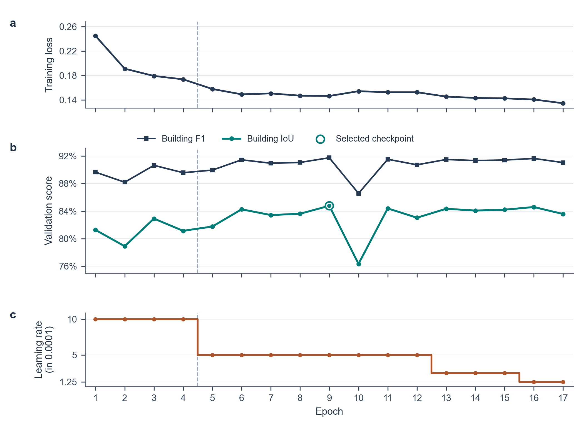
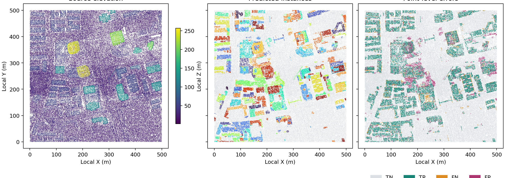
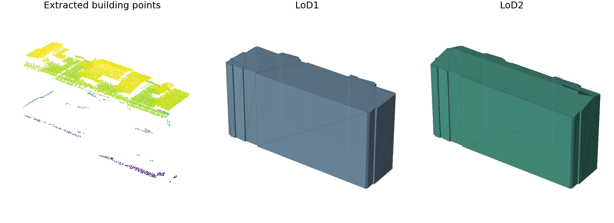

# LitePT 机载 LiDAR 建筑提取与 LoD 重建

本项目使用深圳市高密度城区机载 LiDAR 数据，从头训练 LitePT-S，完成建筑点二分类、单体划分及 LoD1/LoD2 重建。模型在两幅独立测试瓦片的 **21,697,997 个点**上取得 **89.42% F1、80.86% 建筑 IoU**。试验共训练 **17 轮、5,746 次优化更新**，以验证 IoU 最高的第 9 轮权重生成最终成果。本文的最终版本对应 `exp/shenzhen_als/hag_stable/`。 [测试记录](exp/shenzhen_als/hag_stable/test.json)

## 1. 数据与划分

课程数据共 **10 幅 LAS 1.2 瓦片，105,776,133 点**，单幅平面范围约 500 m × 500 m。按整幅瓦片划分，随后分别在各集合内切块。验证瓦片位于测区东侧，测试瓦片位于测区北侧。投影坐标沿用原始 LAS 的米制坐标，部分文件未提供可统一确认的 EPSG 编码。 [瓦片划分清单与范围](splits/shenzhen_als.json)

| 集合 | 瓦片编号 | 原始点数 | 原始点数占比 | 40 m 核心块数 |
| --- | --- | ---: | ---: | ---: |
| 训练 | 0845925、0845930、0845935、0850925、0850930、0850935 | 63,836,850 | 60.35% | 1,014 |
| 验证 | 0845940、0850940 | 20,241,286 | 19.14% | 338 |
| 测试 | 0855925、0855930 | 21,697,997 | 20.51% | 338 |
| 合计 | 10 幅 | 105,776,133 | 100.00% | 1,690 |

以原始 LAS 的 `classification == 6` 定义建筑正类，其余记为背景。训练区类标用于交叉熵监督，验证区类标用于监测收敛和选择权重，测试区类标只参与评分。Class 5 用于统计高植被误检。模型推理读取坐标、强度及从坐标估计的 HAG。每个核心块只输出本块原始点的预测，跨集合取样和跨瓦片上下文均未启用。相邻瓦片交界处仍可能出现被切开的同一建筑，该划分控制的是瓦片级数据交叉。 [预处理与评分代码](tools/shenzhen_als.py)

## 2. 方法与模型改进

### 2.1 点云预处理与预测回映射

1. **定位原始点。** 各瓦片减去 LAS 坐标最小值以获得局部坐标，按 40 m × 40 m 的 XY 核心块建索引，保留原始点序号。输入 XY 以块中心为原点，Z 减去该核心块高程中位数。网络的三维坐标特征除以 10，空间体素坐标仍按米制几何计算。
2. **训练采样。** 每轮打乱训练块顺序，对核心块做绕 Z 轴随机旋转，并从每个 0.5 m 三维体素随机保留一个代表点。强度归一化为 `log(1 + intensity) / log(65536)`。
3. **验证与测试。** 每个核心块额外读取同一瓦片内 3 m 的邻域上下文，按固定点序选体素代表点。取二分类 logits 的最大值作为预测类别，再用体素逆索引将预测赋给该核心块的原始点。全量指标基于原始点计数。 [分块、体素化及回映射实现](tools/shenzhen_als.py)

### 2.2 LitePT-S 与 HAG 输入

LitePT-S 的浅层使用稀疏卷积提取局部结构，深层用带 PointROPE 的注意力汇集上下文。项目保留 LitePT-S 的编码器与解码器，在 72 维输出后接一个线性分类头，输出建筑和非建筑两个 logits。两组均随机初始化。为控制参数量和初始权重，基线和 HAG 模型都使用五通道输入，基线的第五通道置零，HAG 组填入归一化离地高度。 [LitePT 论文](https://arxiv.org/abs/2512.13689) · [本地骨干实现](litept/model.py) · [二分类训练实现](tools/shenzhen_als.py)

HAG（Height Above Ground）以点下方局部地面为参考。每幅瓦片按 10 m XY 网格取最低点，用最近有效格元补空，再做 3 × 3 中值滤波，得到地面高程估计。点高程减去所在格元的地面高程得到 HAG，裁剪到 −10 至 150 m 后除以 10。屋面和树冠都可能具有较高 HAG，其作用需要结合点的邻域几何及实验结果判断。 [HAG 计算与输入编码](tools/shenzhen_als.py)

实现中使用 PyTorch PointROPE 回退、PyTorch SDPA 和分段归约来适配本地 GPU 环境。两组使用同一后端实现，HAG 对照只改变第五通道中的数据。 [后端实现](litept/model.py)

## 3. 训练配置与收敛

### 3.1 实验配置

| 配置项 | 实际设置 |
| --- | --- |
| 初始化与随机种子 | 随机初始化，种子 472 |
| 优化 | AdamW，权重衰减 0.01，梯度范数上限 5.0 |
| 损失 | 二分类交叉熵，未使用类权重 |
| HAG 对照 | 每组 96 个训练块、48 个验证块，批大小 1，3 轮，每轮 96 步，学习率 0.001 |
| 全量前 4 轮 | 1,014 个训练块、338 个验证块，批大小 3，每轮 338 步，学习率 0.001 |
| 全量续训 | 恢复第 4 轮的模型、优化器和随机状态，批大小 3，续训起始学习率 0.0005 |
| 学习率调整 | 自最近一次有效增益和最近一次降学习率均已满 3 轮时减半，最低 0.000015625 |
| 最佳权重 | 按全验证集的最高建筑 IoU 选择 |
| 运行环境 | Windows 主机上的 Ubuntu 20.04 WSL2，RTX 5060 Ti 16 GB，Python 3.10，PyTorch 2.7.0+cu128，spconv-cu126 2.3.8 |

训练损失是每轮优化步交叉熵的算术均值。验证集每轮按全部原始点计数后计算 F1 和 IoU。小规模对照与全量训练采用不同采样规模和批大小，指标应按各自的实验设置阅读。 [对照日志](exp/shenzhen_als/pilot_comparison.json) · [全量日志](exp/shenzhen_als/hag_stable/training.json) · [训练代码](tools/shenzhen_als.py)

### 3.2 学习曲线与停止依据



**图 1　全量 LitePT-S + HAG 训练曲线。** a，训练损失。b，完整验证集的建筑类 F1 和 IoU，空心标记指示按 IoU 选出的第 9 轮。c，每轮实际使用的学习率。竖虚线标出第 4 轮与第 5 轮之间的续训边界，曲线包含全部 17 轮原始记录。前 4 轮的学习率由当时的训练配置补入。 [逐轮日志](exp/shenzhen_als/hag_stable/training.json)

第 4 轮时验证 IoU 为 81.13%，低于第 3 轮的 82.91%。续训后，第 9 轮达到最高验证 IoU **84.77%**，对应 F1 **91.76%**。第 10 轮 IoU 回落到 76.33%，说明验证表现仍有单轮波动。训练损失从第 1 轮的 0.2448 降至第 17 轮的 0.1347。

停止判据同时考虑累计轮数、有效增益、近期波动和学习率：

- 累计至少 16 轮。
- 相对已记录的有效增益基准，至少连续 8 轮没有达到 0.2 个百分点的验证 IoU 提升。
- 最近 6 轮分为相邻的两个三轮窗口，窗口 IoU 中位数之差不超过 0.6 个百分点。
- 当轮学习率不高于 0.000125。

第 17 轮满足全部条件。第 12–14 轮和第 15–17 轮的 IoU 中位数分别为 **84.08%** 和 **84.21%**，相差 **0.13 个百分点**。17 轮共执行 5,746 次更新，最终测试使用第 9 轮权重。这里的稳定指验证集上达到预先设定的停止条件。 [收敛状态与逐轮指标](exp/shenzhen_als/hag_stable/training.json)

## 4. 建筑提取精度

### 4.1 HAG 对照

两组使用同一批训练块和验证块。下表按各组最高验证 IoU 选权重，验证样本共有 2,851,436 个点。 [对照汇总与逐轮指标](exp/shenzhen_als/pilot_comparison.json)

| 模型输入 | 最佳轮次 | Precision | Recall | F1 | 建筑 IoU | 高植被误检率 |
| --- | ---: | ---: | ---: | ---: | ---: | ---: |
| XYZ + 强度，第五通道为零 | 1 | 77.65% | 62.15% | 69.04% | 52.72% | 10.75% |
| XYZ + 强度 + HAG | 3 | 89.11% | 80.67% | 84.68% | 73.43% | 10.59% |

HAG 组的验证 IoU 提升 **20.71 个百分点**，建筑查准率和召回率均提高。高植被误检率仅降低 **0.16 个百分点**。在这个固定划分和随机种子的小规模对照中，观察到的收益主要体现在整体建筑分割。全量阶段训练了 HAG 版本，特征效应的直接对照来自本节的小规模试验。

### 4.2 全量测试

Precision = TP/(TP + FP)，Recall = TP/(TP + FN)，F1 = 2TP/(2TP + FP + FN)，建筑 IoU = TP/(TP + FP + FN)。高植被误检率的分母是原始 Class 5 点数，分子是其中被预测成建筑的点数。总体结果先汇总两幅瓦片的混淆矩阵，再计算各指标。 [最终测试指标](exp/shenzhen_als/hag_stable/test.json)

| 测试范围 | TP | FP | FN | TN | Precision | Recall | F1 | 建筑 IoU |
| --- | ---: | ---: | ---: | ---: | ---: | ---: | ---: | ---: |
| 0855925 | 2,537,629 | 450,612 | 215,871 | 7,088,061 | 84.92% | 92.16% | 88.39% | 79.20% |
| 0855930 | 2,389,974 | 233,782 | 266,302 | 8,515,766 | 91.09% | 89.97% | 90.53% | 82.70% |
| 两幅合计 | 4,927,603 | 684,394 | 482,173 | 15,603,827 | **87.80%** | **91.09%** | **89.42%** | **80.86%** |

| 检查点来源 | Precision | Recall | F1 | 建筑 IoU | 高植被误检率 |
| --- | ---: | ---: | ---: | ---: | ---: |
| 4 轮训练的最佳权重（第 3 轮） | 82.50% | 93.76% | 87.77% | 78.20% | 11.18% |
| 稳定停止后的最佳权重（第 9 轮） | 87.80% | 91.09% | 89.42% | 80.86% | 6.63% |

续训检查点在同一测试集把建筑 IoU 提高 **2.66 个百分点**，FP 减少 391,802 点，FN 增加 144,349 点。最终高植被误检 472,891 点，占全部 FP 的 **69.10%**。其中 0855925 的高植被误检率为 **10.25%**，高于 0855930 的 **4.44%**，是本次测试中值得对照查看的误差差异。 [4 轮测试记录](exp/shenzhen_als/full_hag/test.json) · [最终测试记录](exp/shenzhen_als/hag_stable/test.json)



**图 2　0855925 的建筑提取与误差。** 左图按原始点的局部高程着色，中图按候选单体编号着色，右图按 TP、FP、FN、TN 显示分类结果。三幅图展示同一批 220,000 个可视化样本，表中精度来自全量点。第二幅测试瓦片可用于对照同类误差。 [0855930 提取图](exp/shenzhen_als/hag_stable/0855930_extraction.png)

在 0855925 上按 10 m 格网统计 Class 5 误检点后，误检点数最多的格元位于源坐标 X ≈ 792830–792840 m、Y ≈ 385870–385880 m，对应图 2 的局部 X 330–340 m、Y 370–380 m。该格元有 5,270 个 Class 5 点，其中 2,245 个被判为建筑，占 42.60%。高树冠与屋面都可能有相近的离地高度，局部连片的冠层也可能具备相似的表面结构。这是该现象的一种解释，格元统计直接验证的是误检的位置和数量。 [逐点 LAZ](exp/shenzhen_als/hag_stable/0855925_instances.laz)

## 5. 单体划分与 LoD 重建

### 5.1 单体划分

将建筑掩膜投影到 0.5 m XY 格网，取每个有点格元的最高点高程。对占据格网做 3 × 3 闭运算补接小空隙，再按四邻接构图，保留高程差不超过 2.0 m 的连接。每个候选实例至少覆盖 80 个原始占据格元，对应约 20 m²。将连通分量编号映射回原始建筑点。 [单体划分实现](tools/shenzhen_lod.py)

| 测试瓦片 | 预测建筑点数 | 已分配实例的点数 | 候选实例 |
| --- | ---: | ---: | ---: |
| 0855925 | 2,988,241 | 2,870,640 | 373 |
| 0855930 | 2,623,756 | 2,536,450 | 322 |
| 合计 | 5,611,997 | 5,407,090 | **695** |

LAZ 保留原始分类，并新增 `BuildingPred` 和 `Building_ID`。`BuildingPred=1` 表示模型预测为建筑。`Building_ID=0` 包含背景和未归入保留实例的预测建筑点。编号在每幅瓦片内有效，用“源瓦片 + 编号”辨识实例。695 是候选数量，课程数据提供逐点建筑类标，实例准确率需另有逐栋参考。 [实例汇总](exp/shenzhen_als/hag_stable/instances.json) · [0855925 LAZ](exp/shenzhen_als/hag_stable/0855925_instances.laz) · [0855930 LAZ](exp/shenzhen_als/hag_stable/0855930_instances.laz)

### 5.2 LoD1 与 LoD2

样例为 0855925 的 `Building_ID=23`，包含 **43,424 点**。从 0.5 m 格元最高点提取屋面候选，以格元联合及 0.4 m 轮廓简化获得基底轮廓。附近低位点的第 10 百分位用于估计地面，样例地面高程为 **20.83 m**，轮廓投影面积为 **809.75 m²**。 [重建代码](tools/shenzhen_lod.py) · [样例参数与质检](exp/shenzhen_als/hag_stable/lod/reconstruction.json)

- **LoD1** 用拟合屋面样本的高程中位数建立水平顶面，将轮廓向地面拉伸成闭合体。
- **LoD2** 拟合沿分界线连续的两个屋面平面。用 60% 屋面格元拟合平面、20% 选择分界线、20% 留出计算误差。沿屋面分界切开轮廓并三角剖分，缝合屋面、侧墙和底面。样例筛选偏向具有双平面拟合收益的建筑，因此结果用于说明该案例的屋面表达效果。 [OGC CityGML LoD 定义](https://docs.ogc.org/is/20-010/20-010.html)

| 模型 | 留出屋面点覆盖率 | 高程 RMSE | 高程 MAE | 三角面数 | 拓扑 |
| --- | ---: | ---: | ---: | ---: | --- |
| LoD1 | 100.00% | 1.410 m | 1.302 m | 148 | 单个闭合体 |
| LoD2 | 100.00% | 1.255 m | 1.066 m | 156 | 单个闭合体 |

在同一批 **637 个留出屋面点**上，LoD2 将高程 RMSE 降低约 **11.0%**。误差定义为点高程与同 XY 处模型屋面高程之差。覆盖率指留出屋面点落在模型平面轮廓内的比例。该评价反映样例屋面拟合，实测立面和绝对地面高程未作独立检核。OBJ 顶点使用局部米制坐标，叠加质检文件中的 `origin_m` 可回到源坐标。 [重建质检](exp/shenzhen_als/hag_stable/lod/reconstruction.json) · [LoD1 OBJ](exp/shenzhen_als/hag_stable/lod/lod1.obj) · [LoD2 OBJ](exp/shenzhen_als/hag_stable/lod/lod2.obj)



**图 3　同一栋建筑的重建结果。** 从左到右依次为提取的单体点云、水平顶面的 LoD1 和双平面屋顶的 LoD2。

## 6. 复现实验

从 LitePT 项目根目录运行以下 Bash 命令。使用支持 Blackwell 的 PyTorch/CUDA 环境。本次环境对应 `torch==2.7.0+cu128`、`torchvision==0.22.0+cu128` 和 `spconv-cu126==2.3.8`，并使用 `timm`、`addict`、`colorhash`、`laspy`、`lazrs`、`numpy`、`scipy`、`shapely>=2.1`、`trimesh` 和 `matplotlib`。源代码基于本地上游提交 `436d048`。以下命令写入新目录 `exp/shenzhen_als_repro`。 [训练入口](tools/shenzhen_als.py) · [重建入口](tools/shenzhen_lod.py) · [上游仓库](https://github.com/prs-eth/LitePT)

```bash
export PYTHONPATH=.
litept_cache="$PWD/data/shenzhen_als"
litept_runs="$PWD/exp/shenzhen_als_repro"

python tools/shenzhen_als.py --prepare --cache "$litept_cache"

for variant in base hag; do
  python tools/shenzhen_als.py --cache "$litept_cache" \
    --variant "$variant" --output "$litept_runs/pilot_$variant" \
    --train-blocks 96 --val-blocks 48 --epochs 3
done

python tools/shenzhen_als.py --cache "$litept_cache" \
  --variant hag --output "$litept_runs/full_hag" --batch-size 3 --epochs 4 --test

mkdir -p "$litept_runs/hag_stable"
cp "$litept_runs/full_hag/"{checkpoint.pt,model_best.pt,training.json} "$litept_runs/hag_stable/"
python tools/shenzhen_als.py --cache "$litept_cache" \
  --variant hag --output "$litept_runs/hag_stable" --batch-size 3 --resume --until-stable --test

python tools/shenzhen_lod.py "$litept_runs/hag_stable"
```

如续训中断，保留 `hag_stable/checkpoint.pt`，直接重跑带 `--resume --until-stable --test` 的命令。测试表现可能随 GPU 后端和浮点执行顺序略有变化。

| 成果 | 文件 |
| --- | --- |
| 数据清单 | [shenzhen_als.json](splits/shenzhen_als.json) |
| 消融与全量训练 | [pilot_comparison.json](exp/shenzhen_als/pilot_comparison.json) · [training.json](exp/shenzhen_als/hag_stable/training.json) |
| 最佳权重与续训状态 | [model_best.pt](exp/shenzhen_als/hag_stable/model_best.pt) · [checkpoint.pt](exp/shenzhen_als/hag_stable/checkpoint.pt) |
| 最终测试与实例 | [test.json](exp/shenzhen_als/hag_stable/test.json) · [instances.json](exp/shenzhen_als/hag_stable/instances.json) |
| 点云与模型 | [0855925 LAZ](exp/shenzhen_als/hag_stable/0855925_instances.laz) · [0855930 LAZ](exp/shenzhen_als/hag_stable/0855930_instances.laz) · [LoD1 OBJ](exp/shenzhen_als/hag_stable/lod/lod1.obj) · [LoD2 OBJ](exp/shenzhen_als/hag_stable/lod/lod2.obj) |

## 7. 结果边界

这次实验在两幅空间留出的课程瓦片上验证了建筑点提取。HAG 的提升来自固定划分、单种子的对照，迁移到不同城市或传感器仍需验证。逐点分类指标覆盖整幅测试瓦片，实例数量与 LoD 质检分别描述单体候选和一个重建样例。最值得继续核对的是高植被误检，以及高程接近的相邻建筑在连通划分中发生粘连的情况。
