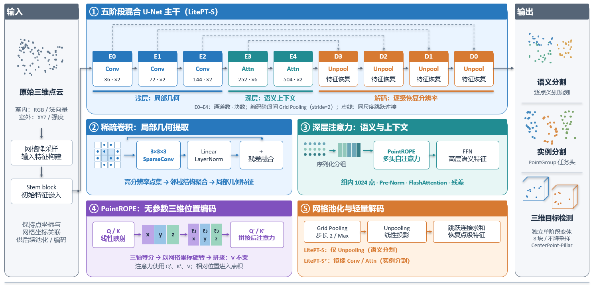
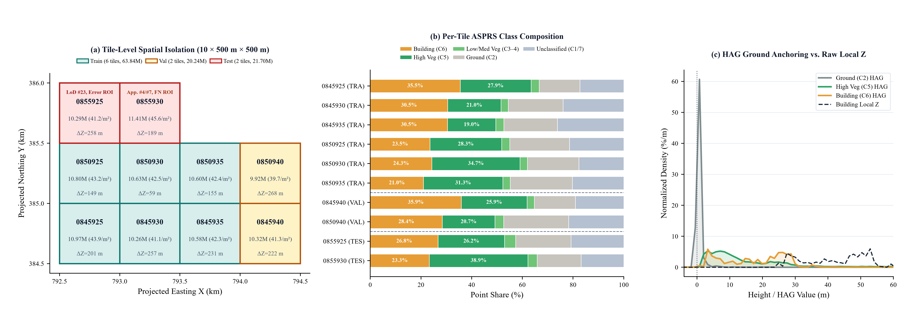
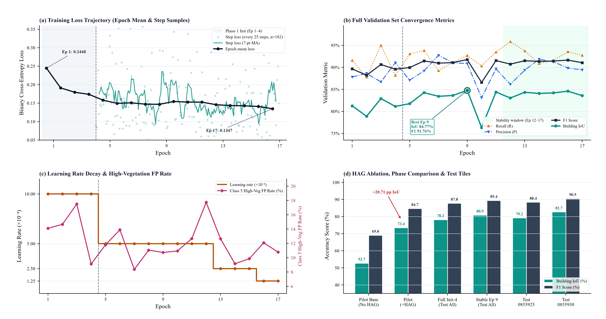
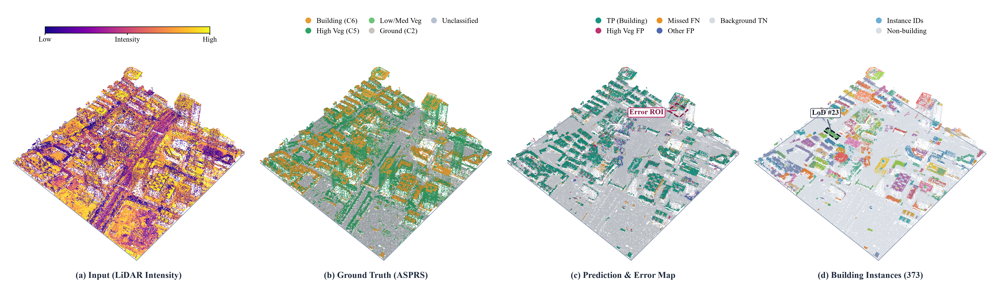
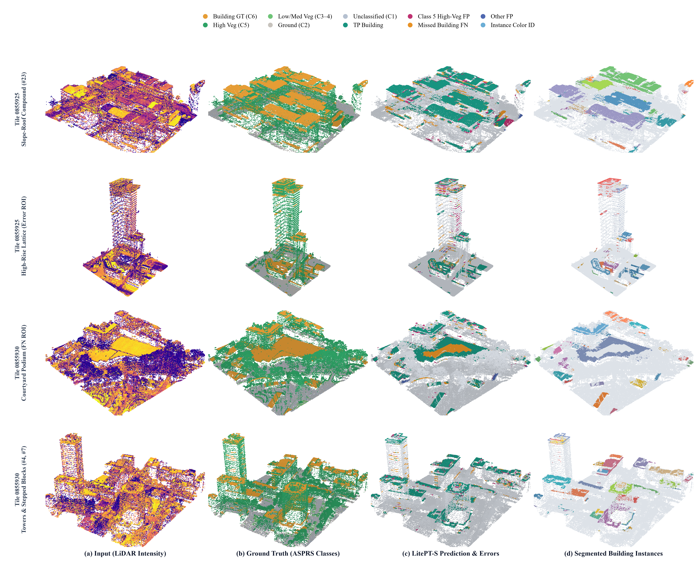
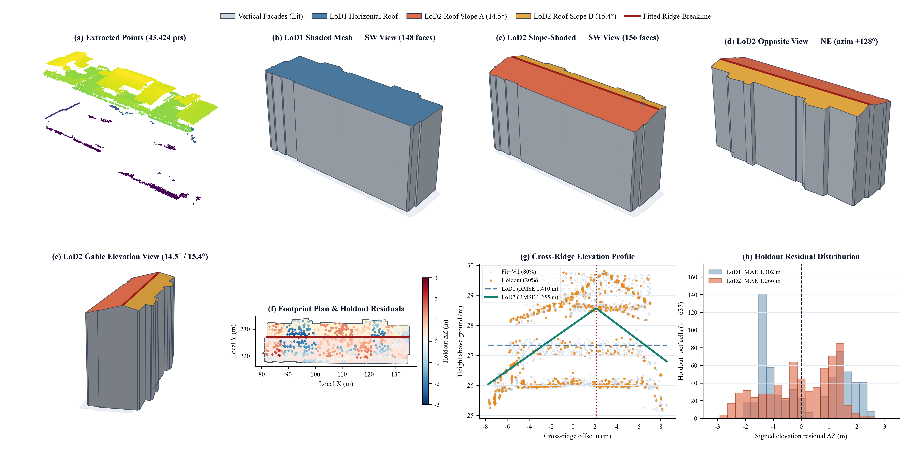
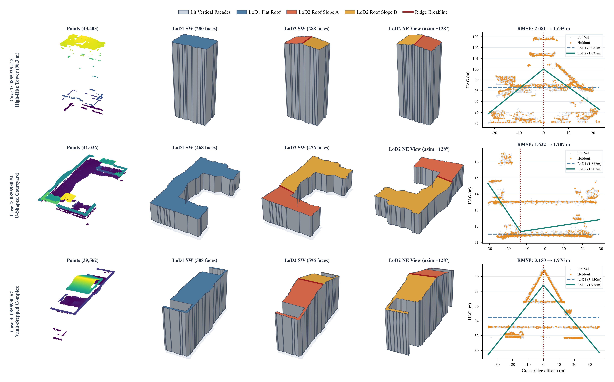
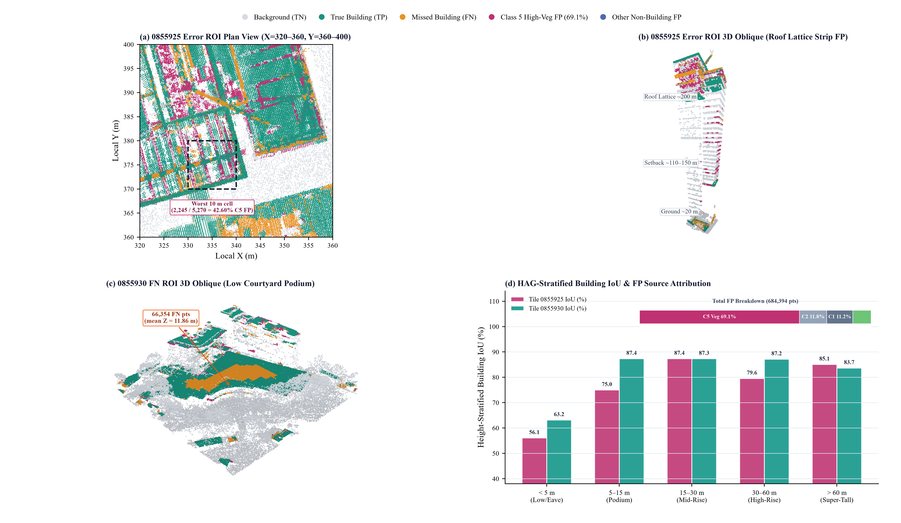

# 基于 LitePT 的机载 LiDAR 建筑物提取与单体化重建

针对复杂高密度城区机载激光雷达（ALS）点云，基于轻量化混合点云 Transformer 主干 **LitePT-S**（引入 10 m 局部地面估计离地高度 **HAG** 先验），实现端到端的逐点建筑语义提取、高差约束邻接建筑单体分割与水密闭合 **CityGML LoD1 / 分段双平面 LoD2** 三维重建。

---

## 目录结构

```text
.
├── LitePT/                         # 核心算法代码、配置与轻量化实验结果（基于 prs-eth/LitePT，MIT）
│   ├── litept/model.py             # LitePT-S 主干（适配 PyTorch PointROPE 回退、SDPA 注意力与 segment_reduce）
│   ├── splits/shenzhen_als.json    # 严格整幅瓦片 6/2/2 空间隔离划分清单（指向 ../../LidarDATA）
│   ├── tools/
│   │   ├── shenzhen_als.py         # 10 m 地面估计 HAG 构建、体素化训练、17 轮稳定训练与逆索引测试评估
│   │   ├── shenzhen_lod.py         # 0.5 m 格网 + 2.0 m 高差约束连通单体划分与水密 LoD1/LoD2 建模
│   │   └── shenzhen_paper_figures.py # 编码器表征 PCA 钩子抽取与训练/误差出图脚本
│   ├── exp/shenzhen_als/           # 可直接查阅的定量 JSON 指标、训练日志、提取预览图与 LoD OBJ 模型
│   │   ├── pilot_comparison.json   # 固定划分 HAG 消融对照结果
│   │   └── hag_stable/             # 第 9 轮最优全量模型测试结果、training.log 及 lod/ (lod1.obj, lod2.obj)
│   ├── LitePT项目说明.md            # 实验流程与逐项指标速查说明
│   └── LitePTPaper.pdf             # LitePT 原论文参考 PDF
├── figures/                        # 网络架构、数据划分、训练曲线、三维点云提取与多视角 LoD 展示图件
└── LidarDATA/                      # [未入库] 原始 10 幅 LAS 1.2 点云瓦片（约 2.82 GB，见下方数据说明）
```

---

## 网络架构与技术路线



- **五通道物理输入**：在标准化 4 维室外点云特征 $[\Delta x/10, \Delta y/10, \Delta z/10, s_i]$ 基础上融入 10 m 局部地面滤波估计并裁剪至 $[-10, 150]$ m 范围的离地高度 $h_i/10$，使跨越两百米高差起伏坡麓的建筑群体共享一致的高度参考基准。
- **分层解耦主干（LitePT-S）**：浅层 **E0–E2**（36–144 通道）仅使用 $3\times 3\times 3$ 稀疏卷积提取屋脊、立面与棱角局部几何；深层 **E3–E4**（252–504 通道）切换为无参数三维旋转位置编码 **PointROPE** 多头注意力捕捉长程城市街区语境；轻量化解码器输出 72 维逐点特征后接入 $72 \to 2$ 二分类头。
- **单体分割与水密 LoD 重建**：将预测建筑点投影至 `0.5 m` 格网，经 $3\times 3$ 闭运算与 $|\Delta z| \le 2.0\text{ m}$ 四邻接连通分量划分建筑单体，继而完成基底轮廓简化、分段连续铰链双平面屋脊拟合及约束 Delaunay 三角剖分流形水密网格封装。

---

## 数据集划分与训练过程



- **数据规模与零重叠划分**：10 幅 `500 m × 500 m` LAS 1.2 瓦片，共 **105,776,133 点**（平均密度 **42.31 点/m²**），严格按整幅瓦片隔离划分为 **训练集 6 幅**（63,836,850 点，1,014 个 40 m 核心块）、**验证集 2 幅**（20,241,286 点，338 块）与 **测试集 2 幅**（21,697,997 点，338 块）。



- **HAG 消融验证**（固定 96 训练块 / 48 验证块、`SEED=472`）：引入 HAG 后，验证集建筑 IoU 由 **52.72%** 跃升至 **73.43%**（**+20.71 pp**），F1 由 69.04% 提升至 84.68%。
- **两阶段稳定训练轨迹**：全量模型共训练 **17 轮（5,746 次梯度更新）**，交叉熵损失由 `0.2448` 稳定收敛至 `0.1347`；第 9 轮取得全量验证最高 **IoU 84.77%** 与 **F1 91.76%**，并经连续三轮窗口稳定性检验（Ep 12–14 与 Ep 15–17 验证 IoU 中位数差仅 `0.13 pp`）自动收敛停训。

---

## 实验结果与三维可视化

### 1. 独立测试集全量逐点定量精度

第 9 轮最优模型在两幅独立测试瓦片全部 **21,697,997 个原始点**（体素逆索引无损回映射）上的评估结果（`LitePT/exp/shenzhen_als/hag_stable/test.json`）：

| 测试瓦片 | TP | FP | FN | TN | Precision | Recall | F1 | IoU | C5 高植被误检率 |
| --- | ---: | ---: | ---: | ---: | ---: | ---: | ---: | ---: | ---: |
| `0855925` | 2,537,629 | 450,612 | 215,871 | 7,088,061 | 84.92% | 92.16% | 88.39% | 79.20% | 10.25% |
| `0855930` | 2,389,974 | 233,782 | 266,302 | 8,515,766 | 91.09% | 89.97% | 90.53% | 82.70% | 4.44% |
| **两幅总体** | **4,927,603** | **684,394** | **482,173** | **15,603,827** | **87.80%** | **91.09%** | **89.42%** | **80.86%** | **6.63%** |

### 2. 全场景三维点云分类、误差与单体分割展示





测试集经 `0.5 m` 格网与 `2.0 m` 高差约束共分离 **695 个候选建筑单体**（分配点数 **5,407,090**）：`0855925` 为 **373 栋**、`0855930` 为 **322 栋**（`LitePT/exp/shenzhen_als/hag_stable/instances.json`）。

### 3. 多视角表面着色 LoD1 / LoD2 建模与残差验证



- 代表双坡屋顶实例 `0855925 Building_ID=23`（43,424 点，占地 `809.75 m²`，637 个 20% 留出屋面点 100% 轮廓覆盖）：**LoD1**（148 面，watertight）留出点 RMSE = `1.410 m`、MAE = `1.302 m`；**LoD2**（156 面，watertight）RMSE 降至 **`1.255 m`**（**-11.0%**）、MAE 降至 **`1.066 m`**。

<details>
<summary>展开查看另外三类建筑原型多视角 LoD1/LoD2 建模结果（超高层塔楼 / U 型合院 / 拱顶复合裙楼）</summary>



</details>

### 4. 误差物理成因定位与 HAG 分层精度



- **误检主要来源（69.10% 来自 Class 5）**：在 684,394 个总误检点 FP 中，472,891 点原标为 Class 5（高植被），空间解剖定位其峰值并非独立公园树冠，而是紧密附着于超高层屋顶绿化格栅与 110–150 m 立面退台的直交构筑物（`0855925 Error ROI`）。
- **漏检主要来源**：标准多层与高层建筑主体层（HAG 15–30 m）两测试瓦片均取得 `87.38% / 87.34%` 的高 IoU，而受乔木冠层与围墙遮挡的低矮围合庭院裙楼（如 `0855930 FN ROI`，均高 `11.86 m`）构成了主要漏检区。

---

## 环境与复现说明

### 1. 数据准备
因 GitHub 单文件限制（100 MB），原始课程 LAS 数据与大体积中间产出未上传，见 `.gitignore`：
- 已排除：`LidarDATA/*.las`（约 2.82 GB）、模型权重 `*.pt`（`checkpoint.pt` 145.7 MB 与 `model_best.pt` 48.6 MB）、输出带属性点云 `*_instances.laz`（108–122 MB）与逐点预测数组 `predictions/*.npy`。
- 如需本地运行训练或推理，请将 10 幅 `.las` 瓦片（`0845925.las`–`0855930.las`）放置于仓库根目录 `LidarDATA/` 下（`LitePT/splits/shenzhen_als.json` 已指向 `../../LidarDATA`）。

### 2. 训练、评估与 LoD 重建命令
```bash
cd LitePT

# 1. 构建体素与 HAG 预处理缓存
python tools/shenzhen_als.py --prepare

# 2. 两阶段全量训练（4 轮初训 + 稳定准则自适应续训与测试）
python tools/shenzhen_als.py --variant hag --output exp/shenzhen_als/hag_stable --epochs 4 --batch-size 3
python tools/shenzhen_als.py --variant hag --output exp/shenzhen_als/hag_stable --resume --until-stable --batch-size 3 --test

# 3. 高差约束建筑单体分割与水密 LoD1/LoD2 建模
python tools/shenzhen_lod.py exp/shenzhen_als/hag_stable
```

---

## 上游致谢与许可

- 本项目点云骨干代码基于 ETH Zurich / University of Oxford / University of Zurich 开源项目 [**prs-eth/LitePT**](https://github.com/prs-eth/LitePT)（CVPR 2026，MIT License，上游基线提交 `436d048`，许可证保留于 [`LitePT/LICENSE`](LitePT/LICENSE)）。
- 为适配单卡 GPU 及跨平台环境，在 [`LitePT/litept/model.py`](LitePT/litept/model.py) 中新增了 `flash_attn` 缺失时的 PyTorch SDPA 注意力回退分支，并将 `torch_scatter.segment_csr` 替换为 PyTorch 原生 `torch.segment_reduce`。
